  

💻 Sou estudante de Análise e Desenvolvimento de Sistemas e uso Python no ambiente profissional para automatizar planilhas, tratar dados e reduzir tarefas manuais. Essa experiência despertou meu interesse pelo desenvolvimento backend, e hoje desenvolvo projetos próprios com Python, Flask, APIs REST e MySQL.

## 🎯 Objetivo profissional

Busco estágio ou vaga de desenvolvedor backend júnior para aplicar meus conhecimentos, colaborar com uma equipe e evoluir tecnicamente em projetos reais.

## 🛠️ Tecnologias

Python · Flask · Flask-RESTful · APIs REST · MySQL · HTML5 · CSS3 · JavaScript · Git · GitHub · Linux

## 📂 Projetos em destaque

### 💈 StudioBlack

Sistema web de agendamento para barbearia, com painel administrativo e interface para clientes.

🌐 [Acessar aplicação](https://studioblack.up.railway.app/) · 💻 [Código-fonte](https://github.com/talysonsouzaa/Studio-Black)

### 🛍️ VitaWear

E-commerce com autenticação de usuários, catálogo de produtos e banco de dados MySQL.

🌐 [Acessar aplicação](https://vittawear.tech/)

### 📊 SheetFlow

Ferramenta em Python para ler, processar e preencher planilhas automaticamente, criada a partir de uma necessidade real do trabalho.

💻 [Código-fonte](https://github.com/talysonsouzaa/SheetsFlowPy)

## 🎓 Formação

- Análise e Desenvolvimento de Sistemas — Cruzeiro do Sul Virtual (Previsão de termino 07/27)
- Formação Python - DIO (Digital Innovation One)
- Flask API e Flask-RESTful - DIO (Digital Innovation One)
- Banco de Dados MySQL (Udemy)
- Claude (Anthropic)
- Desenvolvimento Web: Fundamentos - DIO (Digital Innovation One)
- Git e GitHub - DIO (Digital Innovation One)

## 📫 Contato

💼 [LinkedIn](https://www.linkedin.com/in/talyson-souza-gomes-b71992378) · 📧 Talysonsouzadevpy@gmail.com
